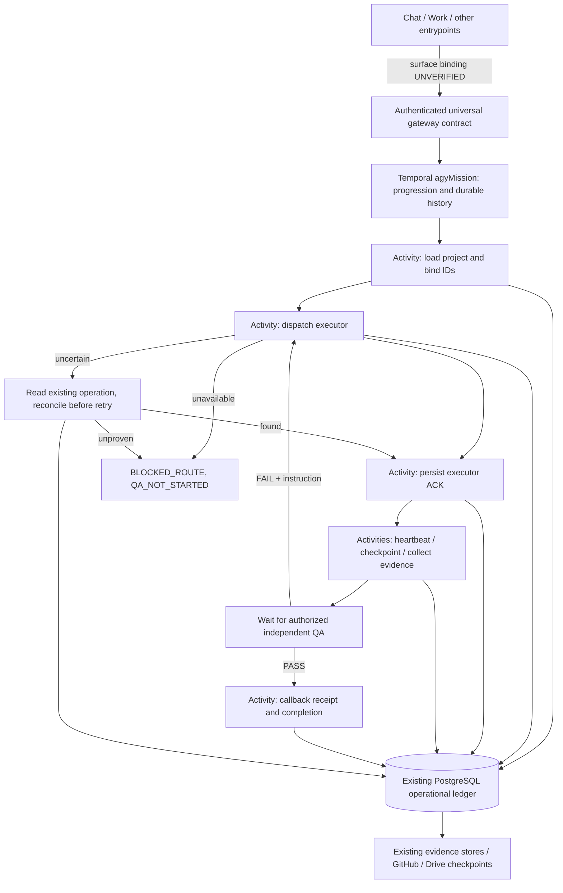

# AGY Temporal shadow integration

Mission AGY-TEMPORAL-20261018. Executor: Codex engineering worker under direct owner instruction. Host/controller reviews the resulting evidence; it does not implement a fallback. No production routing change.

## Authority and flow

Temporal owns orchestration progression/history. PostgreSQL owns AGY projects, jobs, tasks, task attempts, leases, current domain status, ACK/result/QA/callback receipts and evidence references. The gateway returns those authorities separately. A Temporal query is never accepted as proof of domain completion. A successful dispatch HTTP response is not an executor ACK.

`mission_id/task_id/attempt/idempotency_key` remain in the contract and receipts. External task key maps to existing PostgreSQL `job_id/task_id/lease_token`; Temporal `workflow_id/run_id` map through additive `agy_temporal_missions`. Existing events remain append-only in use. Additive receipt tables have forced project RLS and immutable receipt triggers. A canonical payload digest rejects key reuse with changed payload. Workflow IDs are scoped deterministic hashes with reject-duplicate reuse policy.

## Deliberately bounded executable slice

This first slice runs a DB-only synthetic executor in a dedicated project whose policy is `temporalShadowOnly=true`. A strict payload allowlist permits integer `value`, bounded `delay_ms`, and an explicit test fixture. No provider/network/Drive/GitHub operation can be smuggled through that payload. Only `AGY_TEMPORAL_SYNTHETIC` executes. Other executor IDs produce `BLOCKED_ROUTE`; no Work fallback exists. These receipts are **CONTROLLED_SYNTHETIC**, never native provider execution evidence.

The Activities reuse `PostgresStore.createJob`, heartbeat, submission intent, checkpoint and task transition code. The exact synthetic claim is isolated from normal allocation and financial reservations: zero cost/quota, reserved synthetic capability, no native connector. It is not a general replacement for the resource allocator. Native adapters remain unchanged. Enabling native worker dispatch through Temporal requires a separate verified adapter attachment; it is UNVERIFIED in this release.

The workflow contains deterministic timers, conditions and Activity calls only. PostgreSQL, crypto, files and network are outside workflow code. Dispatch has one Activity attempt and an ACK deadline; uncertainty triggers read-only reconciliation. Other Activities use bounded retry and deduplicated receipts. Result polling renews the existing 30-second fenced lease. QA waiting does not require a running executor lease after the task enters QA. After expiry, an Activity explicitly reconciles the persisted ACK, operation and checkpoint under row locks, issues a new lease token and increments the canonical claim attempt while preserving submission attempt and operation ID. Missing/mismatched evidence fails closed. The old fence is never renewed or permitted to dispatch twice.

An authenticated reviewer submits QA. Reviewer identity comes from the existing principal, not the request body. The gateway rejects self-review, premature QA and missing result references, and persists its authorized QA request. The Activity checks that receipt against the signal before accepting it. A direct forged Temporal signal cannot manufacture authorization. FAIL requires an instruction and leads to at most two executor correction attempts; the controller never edits the result to self-pass.

## Source freshness

Read on 2026-10-18: START HERE `10Ph_XvsgytAHsdECGDNkPY94l4EIuTat-4VWtbXrTsY` modified 2026-10-17T09:27:37.356Z; Decision Log `1TFSkLh7ZfAxHq-mYSN-HG2Dp1XJaG_JWcItASe_4tME` modified 2026-10-17T09:27:19.002Z; QA v1.1 `1S98IZWRhF5rDdthPO-y5ETb1shHRS9bz0f_J22yzcqc` modified 2026-10-11T23:18:55.728Z; Worker V2 checkpoint `1mFB9ugcXq9v0K9geDvO8K2-zgn3rWHvSLCAMmct7760` modified 2026-10-12T08:00:41.415Z.

The runtime folder revealed newer TESTED-2 beyond START HERE's TESTED-1 pointer. Baseline package Drive ID `1xzO80QellPlGtxlAWimuF-xfjU7MPsPR`, SHA-256 `CECE24208982EDA501E006479C5E7C1829672B8A0B5B787C57DBA30A3533E843`, checkpoint `1AHtEc1YykbDrdQrz74iy0AGvEqlv3DKh`. Baseline schema contains migrations 001–008; package version remains 1.0.0. Original package has no Git metadata. Local import commit is the reproducible source point, not an invented upstream commit.

Official SDK/setup reference: https://docs.temporal.io/develop/typescript/set-up-your-local-typescript and official replay testing: https://docs.temporal.io/develop/typescript/best-practices/testing-suite (consulted 2026-10-18). SDK pinned at 1.24.0. Local CLI 1.9.1, Server 1.32.0, UI 2.54.1. No account, cloud credential, paid API, purchase or global setup was needed.
